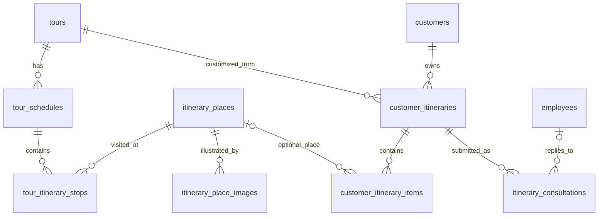

# Lịch trình tour cá nhân và tư vấn báo giá

## Phạm vi và dữ liệu

Đã đọc toàn bộ database hiện tại trước khi thay đổi: **30 tour, 83 ngày**, đối chiếu với `database/data/tours.json`. Giữ nguyên `tour_schedules`, giá, lịch khởi hành và đơn tour hiện có. Phân tách thêm **120 lượt ghé / 112 địa danh** cùng **112 ảnh địa danh** vào `database/data/tour-itineraries.json`.

Điểm tham quan và ảnh được đối chiếu từ Wikipedia/Wikimedia Commons và các trang du lịch đã đọc (Cổng du lịch Côn Đảo, iVIVU, VinWonders, Lữ Hành Việt Nam, PYS Travel, VHA). Có nguồn, ngày đối chiếu, tác giả, giấy phép và SHA-256 cho từng ảnh. Ưu tiên ảnh Commons có giấy phép mở; 9 ảnh từ trang du lịch được ghi rõ chưa xác minh giấy phép mở, không gán nhãn CC cho ảnh đó. Metadata lưu nội bộ; giao diện học tập đã bỏ thông tin nguồn/quyền ảnh.

**Phân biệt bằng chứng:** địa danh/ảnh là dữ liệu từ nguồn công khai. Phân ngày, bữa ăn và hoạt động là chương trình VietGo đã có trong repo; không khẳng định các website nguồn bán đúng chương trình này. Không tự đặt giá vé, giờ mở cửa, thời gian lái xe, thời lượng tham quan hoặc cơ sở ăn/nghỉ chưa được nêu tên. Các hoạt động chung như mua đặc sản/nghỉ ngơi giữ trong ghi chú ngày, không bịa tên cửa hàng/khách sạn. Tọa độ nếu có là tọa độ bài nguồn, có thể là tâm khu vực, không phải cổng vào đã geocode.

Đã rà trực quan bảng ảnh tổng hợp; thay ảnh bản đồ/nhân vật bị nhầm và ảnh không thể hiện đúng nơi, ví dụ Hồ Xuân Hương, Hoa Lư, Hoàng thành Thăng Long, làng Kon Pring. Ảnh thành phố/khu vực chỉ minh họa chính khu vực tương ứng. Không tạo ảnh AI.

## Quan hệ



Một khách có một lịch đang chỉnh cho mỗi tour. Các item riêng cho phép địa danh hoặc hoạt động tự ghi, ngày, thứ tự, giờ, thời lượng và ghi chú. Không ghi đè lịch gốc.

Yêu cầu tư vấn chụp lại ngày, item và nguồn tại lúc gửi. Sau khi khách sửa lịch, bản đã gửi giữ nguyên. Admin/Staff phản hồi dựa trên bản chụp, không dựa vào lịch mới đang thay đổi. Báo giá là tổng cho cả nhóm, có mô tả dịch vụ/điều kiện và hạn hiệu lực; đây chưa phải đơn đặt chỗ hoặc yêu cầu thanh toán.

## Luồng sử dụng

1. Mở `/tours/{id}` (hoặc `/tour/{id}` sẽ chuyển đến trang này), xem phần **Lịch trình của bạn**. Từng ngày có ảnh và tên địa danh.
2. Trên lịch trình gốc ở trang tour, kéo tay nắm **⠿** trên thẻ Ngày 1, Ngày 2… để đổi thứ tự hiển thị; bàn phím hỗ trợ `Alt + ↑/↓`. Trong **Tùy chỉnh lịch & gửi tư vấn**, chọn ngày cho từng hoạt động, thêm/bỏ địa danh, nhập giờ dự kiến, thời lượng hoặc ghi chú rồi chọn **Lưu lịch của tôi**. Lịch cá nhân lưu riêng và không sửa chương trình gốc.
3. Đăng nhập và chọn **Lưu lịch của tôi**. Chương trình và dịch vụ nguyên bản từng ngày cũng được sao thành ghi chú có thể sửa, tránh mất phần di chuyển/bữa ăn khi gửi tư vấn.
4. Chọn ngày đi, số người, liên hệ và nhu cầu thêm rồi **Gửi yêu cầu tư vấn**.
5. Admin/Staff vào **Tư vấn lịch trình**: xem bản đã gửi, trả lời tổng giá/điều kiện/hạn hoặc đóng kèm lý do.
6. Khách xem phản hồi tại **Tài khoản → Lịch tùy chỉnh & yêu cầu tư vấn của tôi**. Báo giá hết hạn được ghi rõ.

Khách chưa đăng nhập được thử chỉnh tại trang nhưng cần đăng nhập để lưu. Lịch riêng không tự thay đổi giá tour, chỗ, đơn hoặc hóa đơn. Staff không thể đặt giá qua API khách. Version chống ghi đè từ hai tab; request UUID chống gửi trùng; quyền xem bản gửi kiểm tra theo chủ lịch. Không cho chọn địa danh ngoài tập điểm của tour, ngày ngoài lịch, giờ chồng nhau/vượt ngày hoặc quá giới hạn item.

## Cài và rà dữ liệu

```powershell
php artisan migrate
php artisan db:seed --class=TourItinerarySeeder
npm run build
php artisan itineraries:audit
```

`DatabaseSeeder` đã gọi `TourItinerarySeeder` sau `TourSeeder`. Không cần xóa hay tạo lại database. Seed lặp giữ ID lịch riêng và yêu cầu tư vấn; kiểm tra checksum ảnh trước khi ghi. Seeder ghép theo tên tour và số ngày hiện có; nếu số ngày đổi thì dừng để rà lại, không âm thầm ghép sai.

`php artisan itineraries:audit --json` kiểm tra **mọi tour trong database**, đủ ngày, liên kết điểm, ảnh local, nguồn/tác giả/giấy phép và checksum; trả exit code khác 0 khi thiếu. Tour mới ngoài snapshot cần bổ sung nguồn và blueprint trước khi coi là đã có đầy đủ dữ liệu.

`scripts/research_itinerary_places.py` thu thập nguồn và tạo hàng chờ rà soát trong ignored `storage/app/itinerary-research`. `scripts/build_itinerary_catalog.py` dùng các ảnh đã chọn, tải thật, kiểm chữ ký JPEG/PNG, ghi snapshot. Không tự chọn ảnh đầu tiên từ kết quả tìm kiếm. Seeder đọc snapshot local nên không cần mạng/API key khi khởi động dự án.

Xem [báo cáo rà từng tour](TOUR_ITINERARY_AUDIT.md). Raw nội dung website nằm ngoài Git; snapshot chỉ giữ dữ kiện cần dùng và attribution, không sao chép toàn bộ bài viết/đánh giá khách.
